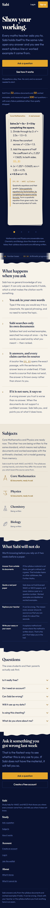
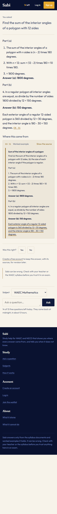
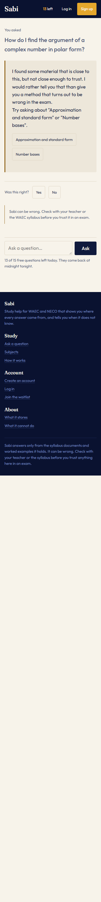
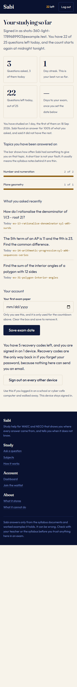

# Sabi

A WAEC study assistant — Core Mathematics, Physics and Chemistry — that answers
from retrieved syllabus text and worked examples, shows the source for every
claim, and says "I don't have that" instead of guessing.

Built for SS3 students in Nigeria studying on cheap Android phones over metered
mobile data.

> **Status: not deployed, and not yet run against a language model.** Everything
> below runs locally today. What is missing and why is in
> [Honest status](#honest-status) — read that before reading anything else.

---

## Why it exists

A student asks an AI a maths question and gets a confident, plausible, wrong
answer, with no way to tell. Two weeks before WAEC, that is worse than no answer
at all.

So the bet: every claim is traceable to a retrieved chunk, the citation is the
most carefully built thing on the page, and the system refuses when retrieval
does not support an answer. Whether it actually does that is
[measured](EVALUATION.md), not asserted.

---

## The numbers

From the committed baseline (`eval/baselines/current.json`), 157 golden items
across WAEC Mathematics, Physics and Chemistry:

| | |
|---|---|
| Retrieval recall@k | 1.000 — and 1.000 in each of the three subjects separately |
| Citation validity | 1.000 — zero invalid citations in 157 answers |
| Answer correctness (deterministic value check, n=91) | 0.989 |
| Unanswerable questions refused | 0.892 |
| Over-refusal on answerable questions | 0.017 |
| Latency p50 / p95 | 41 ms / 74 ms |
| Projected cost per free user per month | $0.025 |

**These come from the offline provider, not from a language model.** Groundedness
scores 1.000 under it, which is a tautology rather than an achievement — the
offline answerer copies its sentences out of the retrieved context. Correctness
is measuring retrieval, and the cost is a price-list estimate. [EVALUATION.md](EVALUATION.md) says exactly which numbers
mean what, and lists all seven remaining failures with their causes.

---

## What it looks like

Captured at 360px, the width of the phones this is for, and at 1440px.
Regenerate with `python tools/shots.py`.

| The landing page | An answer, with its source open |
|---|---|
|  |  |

| A refusal | The dashboard |
|---|---|
|  |  |

The palette comes from **adire eleko**, Yoruba indigo resist-dyed cloth: the
tonal indigo scale is a real material fact, each step a further dip, and the
boundaries between sections are the irregular edge the dye leaves rather than a
ruled line. Type is Fraunces for display and Outfit for everything read or
operated, both self-hosted, 99.6 KB for every weight in the product.

The opened source panel is still the hero element, and the landing page opens
with one rather than describing it: a saffron margin rule down the left like the
ruled margin of a marked script, the provenance in mono at the top, and the
sentence the answer leans on underlined in pen rather than highlighted. The
locator in the answer (`EX 31`) and the locator in the panel header are the same
string in the same colour — the academic-footnote link, made literal.

Full reasoning, and the AI-design clichés the first draft was caught making, in
**[DESIGN_PLAN.md](DESIGN_PLAN.md)**.

---

## Run it

Needs Docker and Python 3.12+. **No API key required** — the offline providers
run the whole system, including the eval suite.

```bash
git clone <this repo> && cd sabi-waec-maths
docker compose up -d db            # Postgres 16 + pgvector on :5433
python -m venv .venv && . .venv/Scripts/activate   # or bin/activate
pip install -e ".[dev]"
cp .env.example .env               # defaults work as-is for local dev

python -m sabi.cli init            # schema, extensions, plan seeding
python -m sabi.cli ingest          # 163 documents -> 507 chunks
python -m sabi.cli serve           # http://127.0.0.1:8000
```

Or the whole thing at once: `docker compose up`.

### Run it against Claude

```bash
# .env
SABI_LLM_PROVIDER=anthropic
SABI_ANTHROPIC_API_KEY=sk-ant-...
SABI_EMBEDDING_PROVIDER=voyage
SABI_VOYAGE_API_KEY=pa-...
```

Then `python -m sabi.cli reindex` (changing embedder requires rebuilding every
vector; ingest refuses to run otherwise rather than mixing incomparable vectors).

---

## The command line

```
sabi init                    create the schema, seed plans from limits.yaml
sabi status                  what is indexed, which embedder, corpus version
sabi ingest [paths]          ingest documents (default: the whole corpus)
sabi ingest --dry-run        show exactly how a document will be chunked
sabi reindex                 refit the embedder, rebuild every vector
sabi corpus list|show|rm     inspect and remove indexed documents
sabi search "question"       retrieval only, with scores and confidence
sabi ask "question"          the full answer path, metered like a real user
sabi eval                    the evaluation suite
sabi report --days 7         cost, latency, cache and per-user spend
sabi cache stats|clear       semantic cache
sabi plans sync              push limits.yaml into the plans table
sabi serve                   the web app
```

Adding a document to the corpus is: write the markdown with its front matter,
`sabi ingest --dry-run` to check the chunking, `sabi ingest` to commit. No code
change, no redeploy.

---

## How it works

```
question
   │
   ├─ welfare guardrail ─────────────── before any model call, cannot be skipped
   ├─ rate limiter ─────────────────── daily cap, burst, IP backstop; no unmetered path
   ├─ budget kill switch ───────────── cache-only past the monthly ceiling
   ├─ semantic cache ───────────────── numeric guard: same shape, different numbers ≠ hit
   │
   ├─ retrieval ────────────────────── Postgres FTS + pgvector, fused by reciprocal rank,
   │                                   reranked, then sibling expansion
   ├─ refusal check ────────────────── grounded out-of-scope, then tuned confidence
   ├─ model routing ────────────────── Haiku 4.5 default, Sonnet 5 on low confidence
   │                                   or a multi-part question
   ├─ generation ───────────────────── answer from retrieved context only
   └─ citation validation ──────────── invented locators stripped; no valid citation
                                       means the answer is discarded, not shown
```

Every request writes a row with the retrieved chunk ids, the model, the prompt
version, the retrieval confidence, tokens, cost and latency — enough to
reconstruct any answer exactly when someone down-votes it three weeks later.

### Layout

```
corpus/          163 markdown documents with YAML provenance front matter
                 (WAEC Mathematics, Physics and Chemistry)
sabi/
  corpus/        loader, chunker, ingestion pipeline
  retrieval/     embeddings, pgvector + FTS store, RRF fusion, reranking
  answer/        prompts, guardrail, refusals, cache, routing, the request path
  llm/           provider interface, Anthropic client, offline extractor, pricing
  accounts/      passwords, sessions, recovery codes, login throttle, identity
  practice/      question templates, set building, marking, weak topics
  limits/        metering, rate limiting, budget kill switch
  billing/       the payment seam. Unimplemented on purpose.
  obs/           structured logging, the cost report, the dashboard queries
  api/           FastAPI app, deps, templates, one stylesheet, two webfonts
evalharness/     the evaluation suite
eval/            golden dataset, rubric, committed baseline, threshold sweep
tools/           threshold sweep, contrast checker, schema drift, screenshots
```

### Accounts

Optional, and the design decision worth knowing is that **signing up does not
create a user**. It sets credentials on the identity the device already had, so
the questions asked beforehand are already yours with no migration, and the
daily allowance cannot be reset by making an account — the cap rises instead,
which is a row in `plans` rather than a schema change.

Logging in on a second device deliberately does *not* absorb that device's
history. It may belong to a sibling or a cybercafé, and importing a stranger's
questions into your notebook is a real leak. There is an explicit merge, and it
defaults to no.

Passwords are `hashlib.scrypt` with the parameters stored inside the hash, so
they can be raised later without invalidating anyone. Sessions are rows, not
signed cookies, so they can be revoked. Every state-changing POST carries a CSRF
token — including anonymous ones, because asking a question spends an allowance
and writes a row.

---

## Evaluation

The harness was built before the retrieval was tuned, so that improvements could
be measured rather than felt. It calls the same entry point the web app calls,
through the same limiter.

```bash
python -m sabi.cli eval                                      # full run
python -m sabi.cli eval --baseline eval/baselines/current.json
python tools/sweep_thresholds.py                             # re-tune the thresholds
```

CI runs it on every push against a real Postgres, gated on both a baseline
comparison and absolute floors. Citation validity has zero tolerance.

Full methodology, the honest failure list, and what the measurement itself gets
wrong: **[EVALUATION.md](EVALUATION.md)**.

Every significant tradeoff and why: **[DECISIONS.md](DECISIONS.md)**.

The interface, written before any code: **[DESIGN_PLAN.md](DESIGN_PLAN.md)**.

---

## Privacy

The users are minors, so the rule is to collect as little as possible:

- **Accounts are optional.** Asking with no account still works, still costs
  nothing, and is still the default — that has not changed.
- If you make one: an email address, and a password stored as a scrypt hash.
  No name, no phone number, no school. Nothing is ever sent to the address,
  because there is no email transport; recovery codes are the way back in.
- Anonymous visitors keep the same random device-scoped id in a signed cookie.
- IP addresses are stored only as a salted one-way hash, only for the rate
  limiter.
- No adverts, no third-party trackers, nothing sold.

Said in plain words to students at `/privacy`, not buried in a policy.

---

## Honest status

What is real, and what is not:

| | |
|---|---|
| Corpus, retrieval, refusal, citations | **Working**, measured, tested |
| Evaluation harness, CI gate | **Working** — 157 items across three subjects, per-subject gates, runs with no API key |
| Cost, metering, budget kill switch | **Working**, exercised by the suite |
| Web interface | **Working** locally. Landing page, study surface, accounts, dashboard. 22KB landing, 5KB study, 8KB answer |
| Accounts, sessions, CSRF, throttling | **Working**, 19 tests, no new dependencies |
| Dashboard: stats, streak, topics, countdown | **Working**, all reads over the existing request log |
| Notebook: kept answers with their sources | **Working**, snapshotted so a saved answer cannot drift |
| Practice: timed sets, marking, weak topics | **Working**, 50 templates, every answer computed in Python |
| Feedback loop and review queue | **Working**, promotion into the golden set tested |
| Run against Claude or Voyage | **Never done.** No API key was available. The clients are written and the seams are tested against fakes, but no real inference call has been made. |
| LLM-as-judge | **Never run.** Rubric written and wired; the numbers in EVALUATION.md come from the heuristic stand-in. |
| Public URL | **Not deployed.** `Dockerfile`, `docker-compose.yml` and `fly.toml` are here and the image builds clean, but deploying needs accounts and payment details that are the repo owner's to provide. |
| Demo video | **Not recorded.** The brief asked for a two-minute walkthrough; there are screenshots above instead. A video needs a deployed URL to walk through. |
| Real users | **None.** The brief asked for a shipped tool with real students; this is a complete system that has not been put in front of anyone. |

**Still to come, and scoped in the plan:** photo input, and Biology. Scoping,
Physics, Chemistry, the notebook and practice have landed. NECO ships as code
rather than content: `exam_board` is threaded everywhere, so adding it is
authoring documents, not changing the system.

The last three rows are the honest gap between this and the brief. They need an API
key, a Fly.io account and a link handed to actual students — decisions and
credentials that belong to whoever owns this, not to the build.

### What I would do next, in order

1. **Run the suite against Claude and the real judge.** Groundedness and
   correctness become meaningful numbers rather than tautologies, and the LLM
   judge path gets exercised for the first time.
2. **Fix the two conceptual over-refusals.** Short questions like "what does the
   discriminant tell you" are the weak spot; the confidence formula reads thin
   support as uncertainty.
3. **Add a corpus document listing what Core Mathematics excludes entirely** —
   complex numbers, the binomial theorem for a general index — so those refusals
   become grounded instead of falling through to a threshold.
4. **Deploy to Fly in Johannesburg** (closest region to Lagos) and give the link
   to a handful of SS3 students.
5. **Then re-tune against real questions**, because the golden set is written by
   someone who is not the user.
